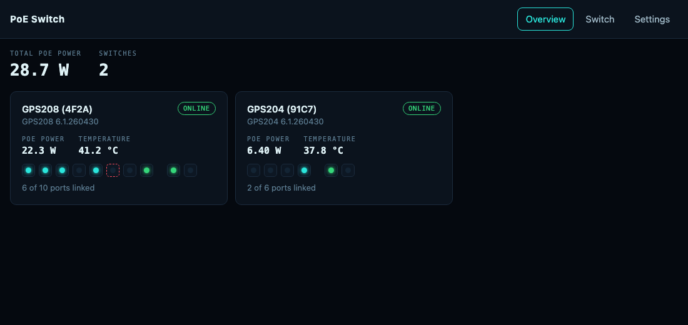
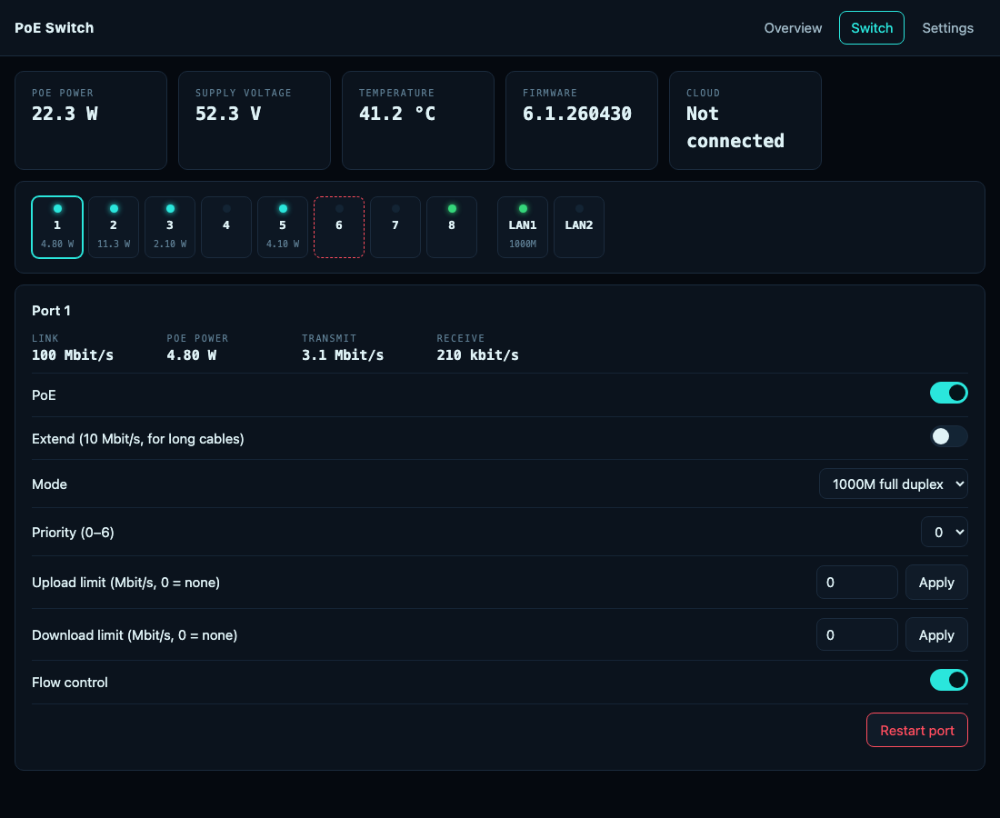
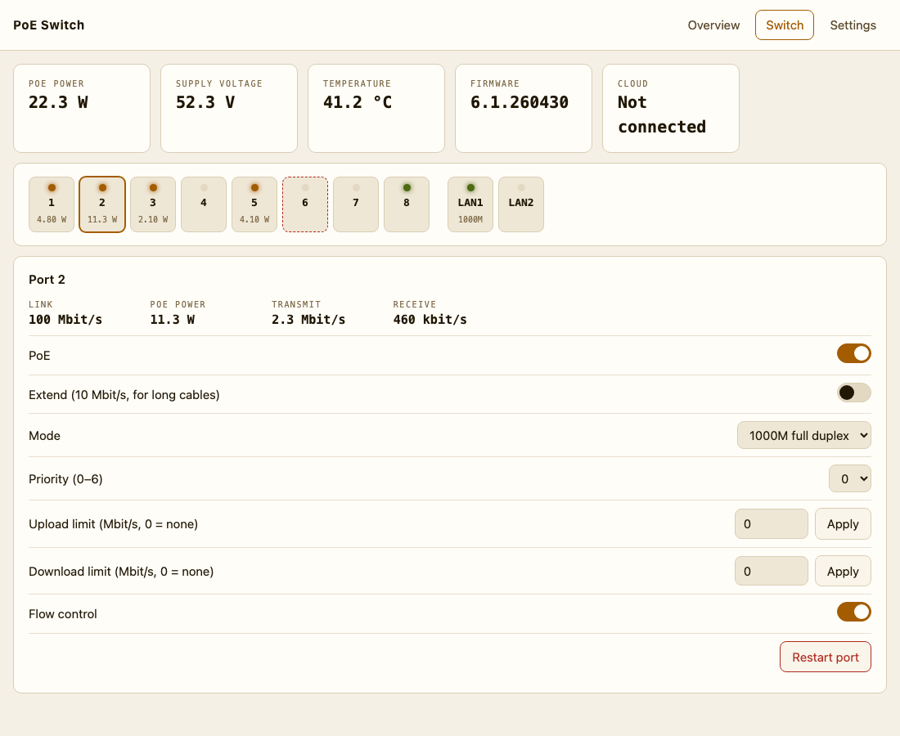
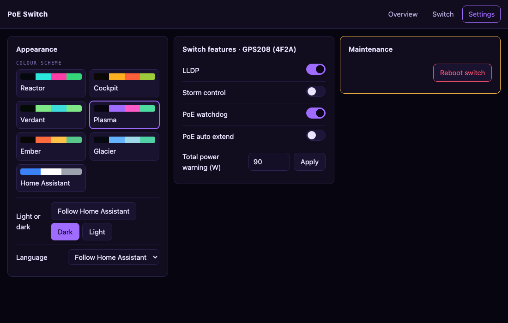
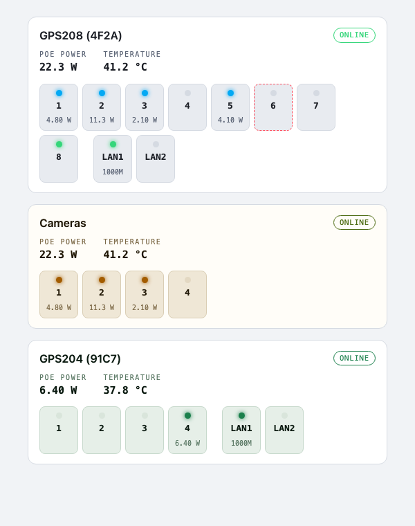

# Goalake / Amitres PoE Switch für Home Assistant

[English version](README.md)

Lokale Steuerung von **Goalake / Amitres PoE-Switches** (die Cloud-verwaltete „Cloud Switch"-Reihe von Shenzhen SSC) in Home Assistant:
Sensoren, PoE-Steuerung pro Port, ein Dashboard-Panel und eine Lovelace-Karte. Ohne Cloud, ohne zusätzliche Python-Pakete.

> Inoffiziell. Dieses Projekt steht in keiner Verbindung zu Goalake, Amitres oder Shenzhen SSC und wird von ihnen nicht unterstützt.
> Getestet mit einem **GPS208 (V3), Firmware 6.1.260430**. Andere Modelle mit derselben Weboberfläche laufen wahrscheinlich, sind aber ungetestet.



## Funktionen

- Eingangsspannung, PoE-Gesamtleistung, Temperatur, Cloud-Status
- Pro Port: Link, Geschwindigkeit, Traffic, PoE-Leistung, **PoE an/aus**, **Extend** (10-Mbit/s-Modus für lange Kabel), Port-Modus, Priorität,
  Ratenlimits, Flusssteuerung, Port-Neustart
- Pro Switch: LLDP, Storm-Control, PoE-Watchdog, Auto-Extend, Warnschwelle für die Leistung, Neustart
- Findet Switches selbst (Netzwerksuche im Hinzufügen-Dialog, Hintergrundsuche, DHCP) und folgt einem Switch, der eine neue Adresse bekommt
- Mehrere Switches gleichzeitig
- **Dashboard-Panel** in der Seitenleiste: Übersicht, Port-Frontansicht, Einstellungen pro Port, sieben Farbschemata, Hell/Dunkel, Deutsch und Englisch
- **Lovelace-Karte** mit Editor in der Oberfläche
- Änderungen erfordern einen Home-Assistant-**Administrator**, auf dem Server geprüft (nicht nur im Browser versteckt)
- Passwörter, Sitzungs-IDs, Seriennummern und MAC-Adressen erscheinen weder im Log noch in der Diagnose

## Installation

**HACS:** HACS öffnen → nach *Goalake Amitres PoE Switch* suchen → herunterladen → Home Assistant neu starten.

Findet die Suche nichts, füge es zuerst als benutzerdefiniertes Repository hinzu: HACS → drei Punkte → *Benutzerdefinierte Repositories* →
`https://github.com/sphings79/ha-goalake-amitres-poe-switch` als *Integration*.

**Manuell:** `custom_components/goalake_poe_switch` in den Ordner `custom_components` deiner Home Assistant kopieren und neu starten.

Benötigt Home Assistant 2025.9 oder neuer (entwickelt und getestet mit 2026.10 und 2026.11).

## Einrichtung

1. Stelle den **Modus-Schalter am Gerät auf „Web"**.
2. Vergib zuerst in der Weboberfläche des Switches ein Passwort (Adresse im Browser öffnen).
3. *Einstellungen → Geräte & Dienste → Integration hinzufügen → Goalake Amitres PoE Switch*.
4. Den Switch aus der Liste wählen (oder seine Adresse eintippen) und das Web-Passwort eingeben.

Ein später gefundener Switch erscheint als entdecktes Gerät. Das Abfrageintervall (Standard 30 s) stellst du in den Optionen ein.

### Passwort ändern

Wenn du das Passwort in der Weboberfläche des Switches änderst, **melde dich ab, einmal mit dem neuen Passwort an und wieder ab**. Erst dann klappt die Anmeldung der Integration mit dem neuen Passwort.

### Nur eine Anmeldung gleichzeitig

Der Switch akzeptiert **nur eine Sitzung gleichzeitig**. Die Integration hält ihre Sitzung offen, deshalb lehnt die Weboberfläche des Switches einen Login im Browser
(„Netzwerk abnormal") ab, solange Home Assistant verbunden ist. Nutze stattdessen Panel und Karte oder deaktiviere den Integrationseintrag kurz.
Ist beim Start von Home Assistant noch jemand anderes angemeldet, wird die Einrichtung automatisch wiederholt.

## Dashboard-Panel



Der Seitenleisten-Eintrag **PoE Switch** zeigt alle Switches, die Ports mit Link, Geschwindigkeit und PoE-Leistung sowie Steuerelemente pro Port. Ansehen darf jeder,
ändern nur Administratoren. Farbschema, Hell/Dunkel und Sprache werden pro Benutzer gespeichert.

| | |
|---|---|
|  |  |

## Lovelace-Karte



Im Karten-Dialog *PoE Switch* wählen. Der Editor bietet Switch, Titel, die angezeigten Ports, ob PoE auf der Karte geschaltet werden darf (nur Administratoren)
und ein Farbschema (Standard: folgt deinem Theme).

```yaml
type: custom:goalake-poe-switch-card
entry_id: <Config-Entry-ID, setzt der Editor>
interactive: true
ports: ["1", "2", "3"]
scheme: cockpit
```

## Entitäten

| Entität | Pro | Standard |
|---|---|---|
| Eingangsspannung, PoE-Gesamtleistung, Temperatur | Switch | an |
| Cloud-Verbindung | Switch | an (Diagnose) |
| Link, Geschwindigkeit, Sende-/Empfangsrate | Port (auch LAN1/LAN2) | an |
| PoE-Leistung | PoE-Port | an |
| PoE an/aus, Extend | PoE-Port | an |
| Port-Modus, Priorität, Upload-/Download-Limit, Flusssteuerung, Neustart | PoE-Port | aus |
| LLDP, Storm-Control, PoE-Watchdog, Auto-Extend | Switch | an |
| Warnschwelle, Neustart | Switch | Neustart aus |

Die Ports heißen wie auf dem Gehäuse aufgedruckt (1 bis 8, LAN1, LAN2). **Schreiben ist auf die PoE-Ports begrenzt**: Ein falscher Wert an einem Uplink könnte die
Verbindung zum Switch kappen.

## Sicherheitshinweise

- Der Switch spricht nur unverschlüsseltes HTTP. Stelle ihn in ein Management-Netz oder -VLAN, das nur Home Assistant und Administratoren erreichen.
- Das Passwort liegt wie bei jeder Integration im Config Entry von Home Assistant.
- Die Diagnose verbirgt Passwort, Host, MAC, Seriennummer und Netzwerkeinstellungen.

## Nicht enthalten

VLAN-Bearbeitung (geplant für 1.1.0), Loop-Erkennung, einen einzelnen Port ganz abschalten, Firmware-Update, Passwortwechsel, Backups, Cloud-Zugriff.

## Fehlersuche

| Meldung | Bedeutung |
|---|---|
| „Der Switch hat die Verbindung nicht angenommen ..." | Eine andere Sitzung ist aktiv (Browser?) oder der Switch startet neu. Wird automatisch wiederholt. |
| „Der Switch hat das Passwort abgelehnt." | Falsches Passwort, oder das Passwort wurde geändert, ohne das beschriebene Abmelden / Anmelden / Abmelden. Home Assistant bietet eine erneute Anmeldung an. |
| Der Switch ist gar nicht erreichbar | Prüfe, ob der Modus-Schalter am Gerät auf „Web" steht. |
| Im Hinzufügen-Dialog wird nichts gefunden | Die Suche braucht Home Assistant im selben Netzsegment (kein NAT, kein VLAN ohne Multicast). Gib stattdessen die Adresse ein. |

## Entwicklung

```bash
python3 -m venv .venv && .venv/bin/pip install -r requirements-dev.txt
scripts/test.sh                      # alle Tests
cd frontend && npm install && npm run build   # Panel- und Karten-Bundle neu bauen (eingecheckt)
scripts/dev-ha.sh start              # lokale Home Assistant in Docker mit Mock-Switch
scripts/make_screenshots.sh          # Screenshots aus Beispieldaten
```

Das Protokoll steht in [docs/protocol.md](docs/protocol.md). `dev-sim/` enthält einen Mock-Switch und Lese-/Schreib-Proben für ein echtes Gerät.

## Unterstützen

Wenn dir die Integration nützt, gib dem Repository bitte einen **Stern auf GitHub**: So finden andere sie leichter. Du kannst mir auch
[einen Kaffee spendieren](https://buymeacoffee.com/sphings).

## Lizenz

[MIT](LICENSE)
