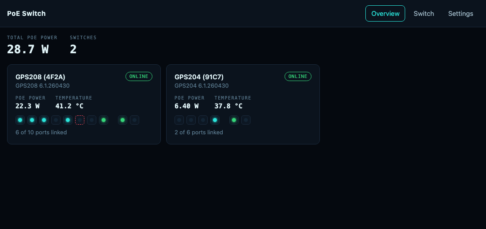
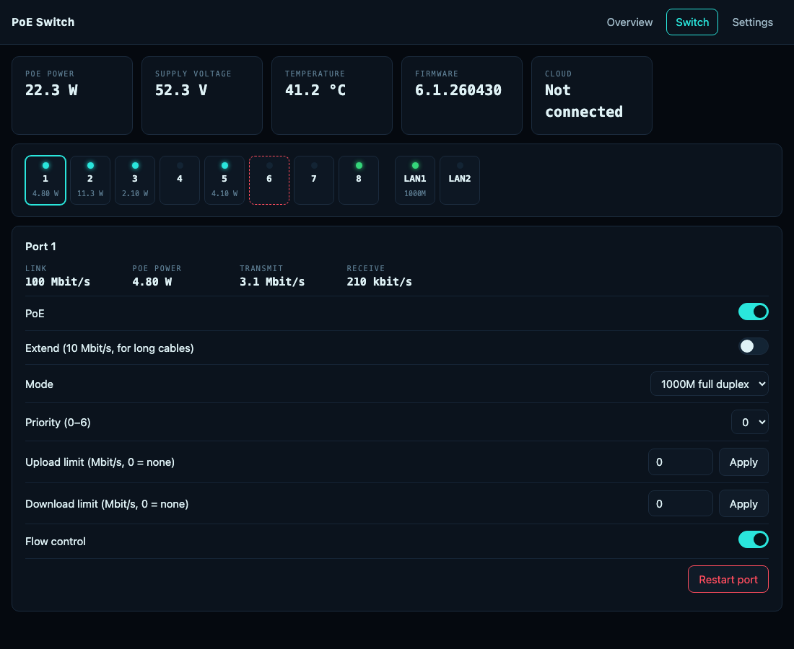
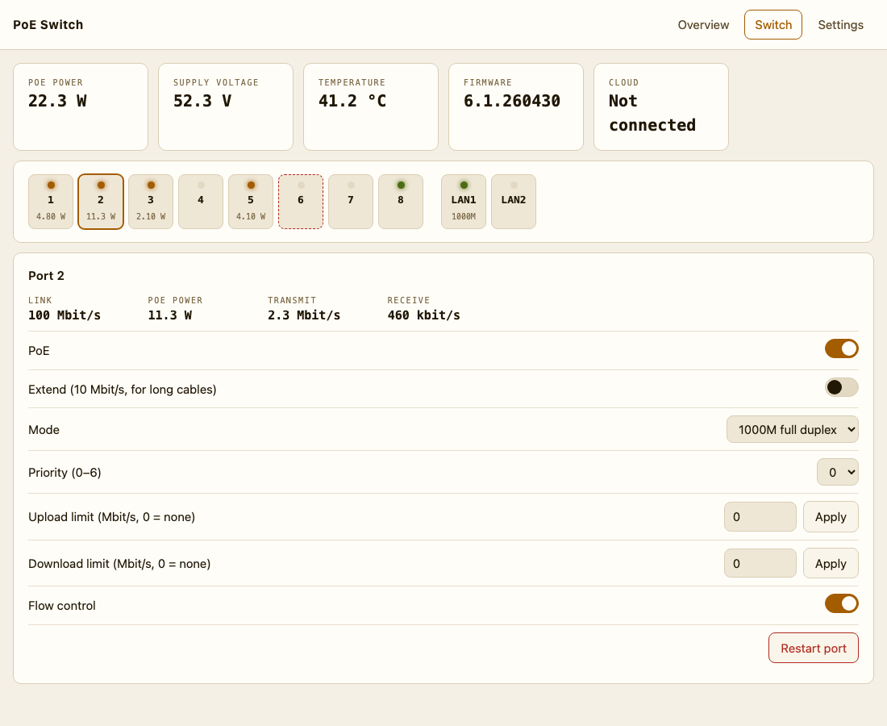
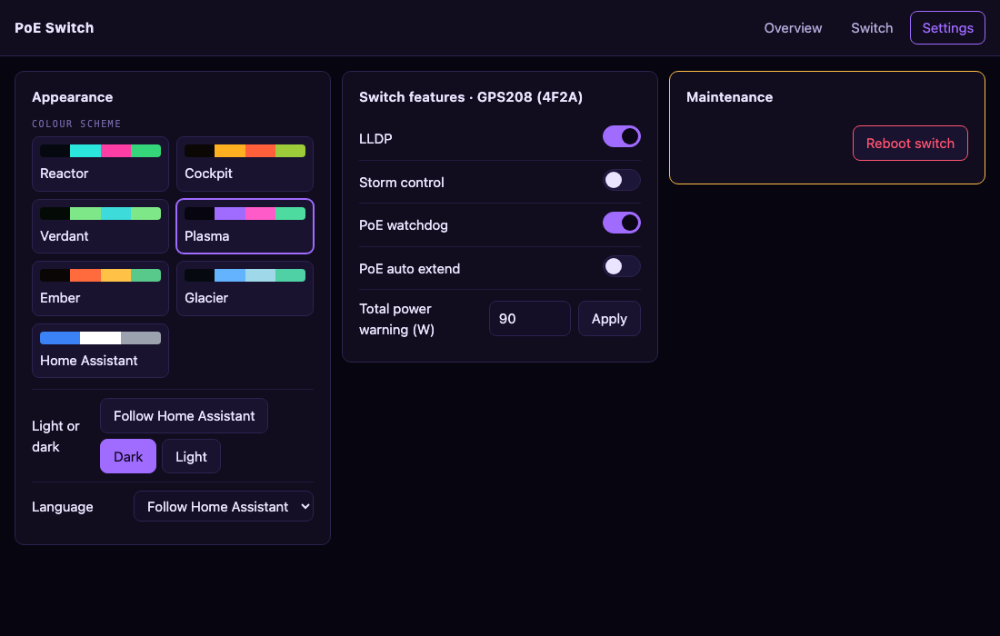
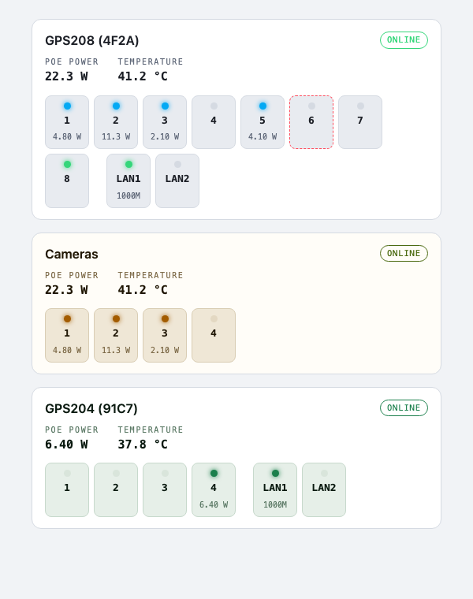

# Goalake / Amitres PoE Switch for Home Assistant

[Deutsche Version](README.de.md)

Local control of **Goalake / Amitres PoE switches** (the cloud-managed "Cloud Switch" series by Shenzhen SSC) in Home Assistant:
sensors, per-port PoE control, a dashboard panel and a Lovelace card. No cloud, no extra Python packages.

> Unofficial. This project is not affiliated with or endorsed by Goalake, Amitres or Shenzhen SSC.
> Tested on a **GPS208 (V3), firmware 6.1.260430**. Other models with the same web interface will probably work, but are untested.



## Features

- Supply voltage, total PoE power, temperature, cloud status
- Per port: link, speed, traffic, PoE power, **PoE on/off**, **Extend** (10 Mbit/s long-cable mode), port mode, priority, rate limits,
  flow control, port restart
- Per switch: LLDP, storm control, PoE watchdog, auto extend, power warning threshold, reboot
- Finds switches by itself (network search in the add dialog, background scan, DHCP); follows a switch that gets a new address
- Several switches at once
- **Dashboard panel** in the sidebar: overview, port front view, per-port settings, seven colour schemes, light/dark, English and German
- **Lovelace card** with a UI editor
- Changes need a Home Assistant **administrator**, checked on the server (not just hidden in the browser)
- Passwords, session ids, serial numbers and MAC addresses never appear in the log or in diagnostics

## Installation

**HACS:** open HACS → search for *Goalake Amitres PoE Switch* → download it → restart Home Assistant.

If the search does not find it, add it as a custom repository first: HACS → three dots → *Custom repositories* → add
`https://github.com/sphings79/ha-goalake-amitres-poe-switch` as *Integration*.

**Manually:** copy `custom_components/goalake_poe_switch` into the `custom_components` folder of your Home Assistant and restart.

Requires Home Assistant 2025.9 or newer (developed and tested with 2026.10 and 2026.11).

## Setup

1. Set the **mode switch on the device to "Web"**.
2. Give the switch a web password in its own web interface first (open its address in a browser).
3. *Settings → Devices & services → Add integration → Goalake Amitres PoE Switch*.
4. Pick the switch from the list (or type its address) and enter the web password.

A switch that is found later shows up as a discovered device. The polling interval (default 30 s) can be changed in the options.

### Changing the password

If you change the password in the switch's web interface, **log out, log in once with the new password and log out again**. Only then does the login of the integration work with the new password.

### One login at a time

The switch accepts **one session at a time**. The integration keeps its session open, so the switch's own web interface refuses
a browser login ("network abnormal") while Home Assistant is connected. Use the panel and the card instead, or disable the integration
entry for a moment. If somebody else is logged in when Home Assistant starts, the setup is retried automatically.

## Dashboard panel



The sidebar entry **PoE Switch** shows all switches, the ports with link, speed and PoE power, and per-port controls. Everyone can look,
only administrators can change something. Colour scheme, light/dark and language are stored per user.

| | |
|---|---|
|  |  |

## Lovelace card



Add *PoE Switch* from the card picker. The editor lets you choose the switch, a title, the ports to show, whether PoE may be switched from
the card (administrators only) and a colour scheme (default: follows your theme).

```yaml
type: custom:goalake-poe-switch-card
entry_id: <config entry id, set by the editor>
interactive: true
ports: ["1", "2", "3"]
scheme: cockpit
```

## Entities

| Entity | Per | Default |
|---|---|---|
| Supply voltage, total PoE power, temperature | switch | on |
| Cloud connection | switch | on (diagnostic) |
| Link, link speed, transmit/receive rate | port (also LAN1/LAN2) | on |
| PoE power | PoE port | on |
| PoE on/off, Extend | PoE port | on |
| Port mode, priority, upload/download limit, flow control, restart | PoE port | off |
| LLDP, storm control, PoE watchdog, auto extend | switch | on |
| Power warning threshold, reboot | switch | reboot off |

Ports are named as printed on the case (1 to 8, LAN1, LAN2). **Writes are limited to the PoE ports**: a wrong value on an uplink could cut the
connection to the switch.

## Security notes

- The switch only speaks plain HTTP. Put it in a management network or VLAN that only Home Assistant and administrators can reach.
- The password is stored in the Home Assistant config entry like for any integration.
- Diagnostics hide password, host, MAC, serial number and network settings.

## Not included

VLAN editing (planned for 1.1.0), loop detection, switching a single port off completely, firmware update, password change, backups, cloud access.

## Troubleshooting

| Message | Meaning |
|---|---|
| "The switch did not accept the connection ..." | Another session is active (browser?), or the switch is restarting. Retried automatically. |
| "The switch rejected the password." | Wrong password, or the password was changed without the log out / log in / log out round described above. Home Assistant offers a re-authentication. |
| Nothing is reachable at all | Check that the mode switch on the device is set to "Web". |
| Nothing found in the add dialog | The search needs Home Assistant in the same network segment (no NAT, no VLAN without multicast). Type the address instead. |

## Development

```bash
python3 -m venv .venv && .venv/bin/pip install -r requirements-dev.txt
scripts/test.sh                      # all tests
cd frontend && npm install && npm run build   # rebuild the panel and card bundles (committed)
scripts/dev-ha.sh start              # local Home Assistant in Docker with a mock switch
scripts/make_screenshots.sh          # screenshots from sample data
```

The protocol is documented in [docs/protocol.md](docs/protocol.md). `dev-sim/` contains a mock switch and read/write probes for a real device.

## Support

If this integration is useful to you, please give the repository a **star on GitHub**: it helps others to find it. You can also
[buy me a coffee](https://buymeacoffee.com/sphings).

## License

[MIT](LICENSE)
